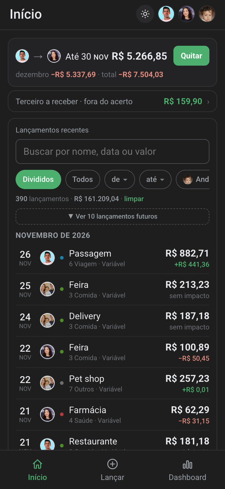
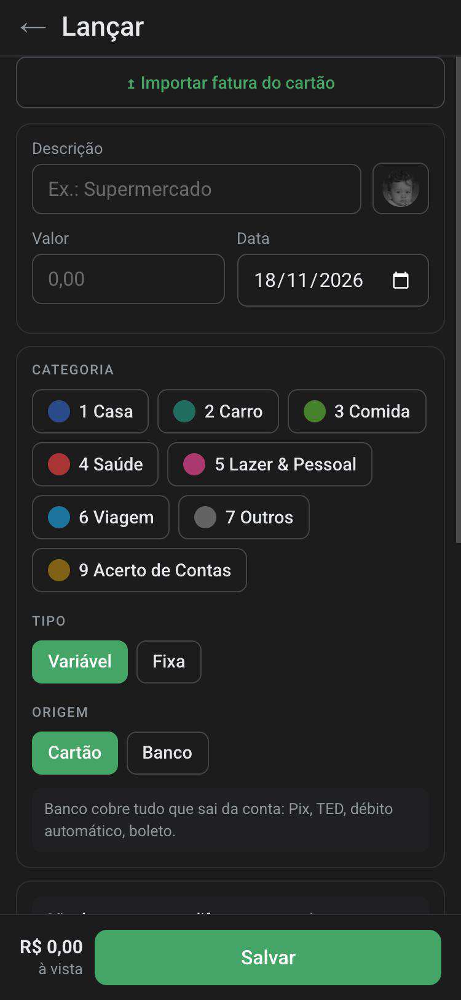
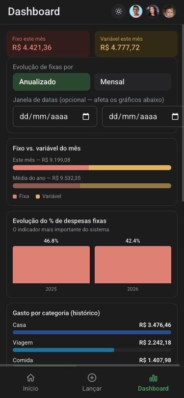
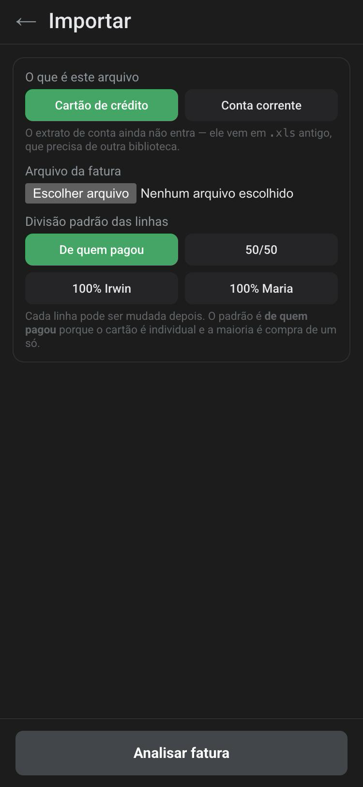

# Mozi's App

**v2.1.0** · Gestão financeira de um casal, em produção desde agosto de 2026.

**[Abrir o demo →](https://mozis-app-demo.vercel.app)** · sem login, com dados
fictícios, e pode mexer à vontade: a base volta ao início toda madrugada.

Este é um app real, usado todo dia por duas pessoas com nome e sobrenome, com
dinheiro de verdade dentro. Não é template nem exemplo didático, e o código está
aberto porque o interessante aqui não é o app, é o **registro do que ele teve que
aprender para não errar uma conta**.

Ele substituiu o Splitwise, que funcionava bem para "quem pagou o quê e quanto um
deve para o outro", mas parava aí. O que faltava era enxergar onde o dinheiro
está indo, se a divisão está justa, quanto custa uma criança na rotina, e como
colocar isso tudo para dentro sem digitar lançamento por lançamento.

Antes dele existiu uma versão em Google Apps Script sobre uma planilha, que rodou
de julho a agosto de 2026 e está preservada em
[mozis-app-legado](https://github.com/irwinalves/mozis-app-legado).

## As telas

Os prints abaixo são do app rodando de verdade, com a base de demonstração
descrita mais adiante. **Os dados são fictícios; o app é o mesmo.** É a mesma
base que está no [demo público](https://mozis-app-demo.vercel.app), então dá
para abrir cada uma destas telas e mexer nelas.

| | | |
|:--:|:--:|:--:|
|  |  |  |
| **Início** — o acerto, quem nos deve, e a lista mostrando o efeito de cada linha | **Lançar** — quem pagou e de quem é o gasto são duas perguntas diferentes | **Dashboard** — o peso das fixas é o indicador que importa |
|  |  |  |
| **Importar** — a fatura do cartão entra em lote | **Revisar** — o app separa o que já existe, o que é parcela e o que é novo, e desmarca o que foi estornado | **Editar** — a linha da fatura vira o Lançar, com menos perguntas |

## Como funciona

| Peça | Escolha |
|---|---|
| Hospedagem | Vercel, função fixada em `gru1` (São Paulo) |
| Banco | Neon Postgres, `sa-east-1` (São Paulo) |
| Backend | Next.js App Router, rota única de RPC em `/api/[metodo]` |
| Front | React, mais `public/Form.html` nas telas ainda não migradas |
| Auth | Auth.js + Google, com allowlist de e-mails |
| Recorrências | Vercel Cron diário, idempotente |

As duas regiões em São Paulo não são detalhe. O app roda no celular de quem está
no Brasil, e manter função e banco do mesmo lado do Atlântico é o que faz a
diferença abaixo.

**Latência medida em produção** (mediana de 5 chamadas), contra o log de Execuções
do Apps Script:

| Chamada | Antes | Agora |
|---|---|---|
| `getOpcoes` | 1.400 a 3.300 ms | 238 ms |
| `ultimosLancamentos` | 4.100 a 4.500 ms | 113 ms |
| `getAcertoContas` | 5.100 a 5.800 ms | 117 ms |
| `getDashboard` | 4.800 a 5.200 ms | 106 ms |

## A ideia que organiza o projeto: regra tem que ser verificável

Num app de dinheiro não existe "quase certo". Um lançamento sem pagador não dá
erro na tela, ele simplesmente sai do acerto em silêncio e o saldo fica errado
para sempre.

Por isso cada regra que este app aprendeu virou texto em
[`docs/INVARIANTES.md`](docs/INVARIANTES.md), sempre com o defeito concreto que a
gerou. São **56 regras numeradas**, e o verificador roda **20 checagens por máquina**
contra o banco de produção:

```bash
npm run invariantes
```

Ele responde uma pergunta por vez. Existe lançamento sem dono? Alguma dívida foi
gravada em vez de calculada? Os dois caminhos que calculam o saldo chegam ao
mesmo número? Essa última já falhou de verdade, e o defeito estava no próprio
teste, não no app. A lição virou a regra A24.

## O demo público, e por que ele não abre o app de verdade

O [demo](https://mozis-app-demo.vercel.app) é este mesmo código, no mesmo
repositório, com outro banco. Abrir uma porta sem login num código que também
roda o app com dinheiro de duas pessoas dentro pede mais cuidado do que uma
variável de ambiente, então são **duas chaves**:

1. a variável `MODO_DEMO=sim`, que só o projeto do demo tem; e
2. a tabela `demo_publico`, que precisa existir no banco.

A segunda não está sob controle de quem configura o deploy. Ela **não existe em
nenhuma migração** — quem a cria é `scripts/semear-demo.ts`, que recusa host
remoto sem `--remoto` e banco com lançamentos sem `--limpar`. O banco do casal
não tem como responder "sim", então ligar a variável no projeto errado não abre
nada: o app continua mandando todo mundo para a tela de entrada.

A mesma marca é a terceira trava do semeador: num host remoto com dados, ele só
apaga uma base que já se declarou de demonstração. É o que deixa a rotina
noturna de reset ser automática sem ser uma máquina de apagar banco.

## Como rodar

```bash
npm install
cp .env.example .env && cp .env .env.local   # preencher
npm run db:migrate && npm run db:views
npm run dev
```

Para exercitar sem credencial OAuth, use `AUTH_BYPASS_DEV=sim` no `.env`. Tem
trava dupla e é inerte em produção, conferido contra build real.

O banco sobe vazio. Para ver o app funcionando com dados:

```bash
npm run semear-demo
```

Ele cria 495 lançamentos fictícios. São dezoito meses cheios, de junho de 2025 a
novembro de 2026, e mais as parcelas que seguem até agosto de 2027, porque um
parcelamento nasce com a série inteira. Dentro vão as despesas fixas com suas
regras de recorrência, dois parcelamentos (um de 6x e um de 12x, que atravessa o
ano), uma importação de fatura, uma quitação entre os dois, um gasto de terceiro
já devolvido e outro em aberto, e a posição mensal de um investimento.

Duas coisas valem ser ditas sobre ele. É **determinístico**, com semente fixa, então
todo mundo vê exatamente a mesma tela. E ele importa `pctIrwinDe` e `pagoIrwinDe`
do próprio app em vez de repetir a aritmética, o que faz os dados semeados
obedecerem às mesmas regras dos reais: `npm run invariantes` roda limpo sobre
essa base, nas 20.

Ele **recusa** rodar num banco que já tem lançamentos (use `--limpar` para apagar
tudo) e **recusa** rodar num host que não seja local (use `--remoto` se for mesmo
o que você quer).

## Comandos

| Comando | O que faz |
|---|---|
| `npm run dev` | Servidor local |
| `npm test` | 81 testes da lógica pura |
| `npm run invariantes` | Verifica 20 regras contra o banco |
| `npm run semear-demo` | Enche um banco vazio com dados fictícios |
| `npm run checar-rotas` | Garante que toda rota tem porta de entrada |
| `npm run checar-form` | Analisa a sintaxe do `Form.html`, que não passa por build |
| `npm run db:generate` | Gera migração a partir de `src/db/schema.ts` |
| `npm run db:migrate` | Aplica migrações |
| `npm run db:views` | Recria as views |
| `npm run reconcile -- <xlsx>` | Compara banco com planilha, linha a linha |
| `npm run prints` | Refaz os seis prints acima contra o app rodando |

## Como replicar na sua casa

Isto aqui não é um template. Os nomes das duas pessoas estão no código, em tipos
e até em nomes de coluna, e foi uma decisão consciente: generalizar custaria uma
reescrita e colocaria em risco justamente o que já funciona.

Se você quiser adaptar, são **seis lugares**, e esta é a ordem que dá menos
trabalho:

1. **`PESSOAS` no `.env`** — `PESSOAS="Ana=ana@exemplo.com,Bruno=bruno@exemplo.com"`.
   Esse é o mapa de quem entra e de quem é quem. Já é configuração, não código.
2. **`src/lib/pessoas.ts`** — o tipo `Pessoa` é uma união de dois literais. Troque
   os dois nomes.
3. **`src/lib/lancamentos.ts`** — os tipos `Divisao` e `QuemPagou` carregam os
   nomes (`'100% Irwin'`). Troque junto, o compilador aponta o resto.
4. **`src/components/Avatar.tsx` e `public/avatar-*.jpg`** — o tipo `Quem` e as
   imagens.
5. **`src/components/DivisaoEPagador.tsx`** — a lista `DE_FORA`, que são as
   pessoas de fora cujo gasto passa pelo cartão de vocês.
6. **`public/Form.html`** — as telas ainda não migradas para React.

**As colunas do banco (`pago_irwin`, `pct_irwin`) não precisam ser renomeadas.**
Renomear exige migração e não muda nada de comportamento. O caminho mais barato é
ler "irwin" como "pessoa 1" e seguir a vida.

## Onde as regras moram

- **Cálculo da divisão:** `pctIrwinDe()` em `src/lib/lancamentos.ts`, e **só ali**.
  O resultado é gravado em `lancamentos.pct_irwin`; a view faz apenas aritmética.
- **Regras de negócio:** [`docs/INVARIANTES.md`](docs/INVARIANTES.md), cada uma com
  o defeito que a gerou.
- **Design:** [`docs/design/README.md`](docs/design/README.md) tem os tokens e a spec
  de cada tela; [`docs/design/BRIEFING-Claude-Design.md`](docs/design/BRIEFING-Claude-Design.md)
  tem o *porquê* de cada regra de negócio.
- **O que a migração descobriu:** [`docs/ACHADOS-DA-RECONCILIACAO.md`](docs/ACHADOS-DA-RECONCILIACAO.md)
- **Como operar:** [`docs/OPERACAO.md`](docs/OPERACAO.md)
- **Como trabalhar neste repositório:** [`CLAUDE.md`](CLAUDE.md). É o arquivo de
  regras que a IA lê no começo de toda conversa, e provavelmente o documento mais
  útil daqui para quem quiser construir software assim.

## O que este app NÃO herdou, de propósito

Três coisas do app antigo eram **contorno**, não regra, e foram removidas depois
de terem sido portadas por engano:

- **Assinatura de conteúdo** para identificar um lançamento, que existia porque não
  havia id. Aqui `id` é chave primária.
- **Quitação reconhecida pelo texto da categoria**, que virou a coluna `eh_quitacao`.
  A string é interpretada em um ponto só, na entrada.
- **A regra de divisão duplicada** em código e em fórmula. Agora existe uma vez.

## Sobre os dados

Nenhum valor financeiro real está versionado aqui. Faturas, extratos, retratos da
planilha e os prints com saldo ficam de fora pelo `.gitignore`, e a documentação
usa ordem de grandeza no lugar dos números da casa. Os nomes e os rostos estão
abertos por escolha de quem aparece neles.

## Licença

MIT. Ver [LICENSE](LICENSE).
